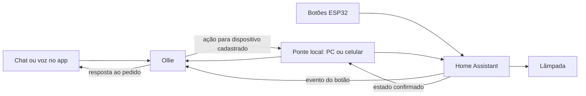

# A Ollie como central da casa

Roteamento por dispositivo e resposta em voz no PC: [Comandos por origem](roteamento-dispositivos.md).
Revisão atual de sites, notificações, dock e wake word: [alterações e verificações pendentes](revisao-sites-dock-wakeword.md).
Treino do detector “Hey Ollie”: [passo a passo no Colab e teste local](treinar-wakeword-ollie.md).
Ativação por voz no celular e navegação: [implementação e validação no Android](wakeword-android.md).
Continuidade após perguntas e retomada da chamada: [turnos de voz e ilha](turnos-voz-android.md).
Interface do computador, navegação e estados: [revisão de UI/UX do PC](revisao-ui-desktop.md).
Buscas, ações por etapa e janelas: [pedidos compostos e primeiro plano](pedidos-compostos-e-foco.md).
Tom das conversas e retorno das ações: [personalidade e confirmações](personalidade-e-confirmacoes.md).
Compromissos, sugestões de datas e despertador: [agenda da Ollie](agenda-e-despertador.md).
Tarefas, pendências e cópias no calendário do celular: [tarefas e calendário](tarefas-e-calendario.md).
Convites, perguntas e rascunhos ligados às rotinas: [ajuda com mensagens](assistencia-mensagens.md).

A conversa acontece com a Ollie. Ela identifica o pedido, encontra o dispositivo
cadastrado e coordena a execução. O Home Assistant comunica com a lâmpada e os
outros dispositivos. O ESP32 acrescenta botões, sensores e atuadores físicos ao
ambiente. O primeiro controle implementado nessa camada é a iluminação.

Gerenciamento das rotinas aprendidas, persistência e ativação pelo app:
[Superpoderes e rotinas](superpoderes-rotinas.md).



## Pedidos disponíveis

- “Ollie, apaga a luz.”
- “Pode desligar as luzes do quarto pra mim?”
- “Quero que você acenda a lâmpada do meu quarto.”
- “Como está a luz?”
- “A luz está acesa?”

Esses pedidos simples são interpretados sem LLM. Perguntas de estado não alteram
a luz. Negações e frases condicionais não são interpretadas como ordens simples.
Pedidos mais elaborados seguem o raciocínio existente, mas suas ações de luz
também passam pelo controlador da casa. Uma notificação externa não autoriza
acionamento físico por esse caminho.

## Implementação

`config/casa.json` associa nomes/apelidos a dispositivos reais. O único dispositivo
inicial é `luz_quarto`, entidade `light.yeelink_color5_027d_light`. Uma luz não
cadastrada ou um apelido ambíguo gera um pedido de esclarecimento; não é substituído
silenciosamente pela luz do quarto.

`AgenteReflexo` publica `CASA_ACAO_SOLICITADA` para pedidos simples. As ações de
iluminação produzidas pela LLM são normalizadas pelo mesmo caminho.
`AgenteCasa` mantém uma fila por dispositivo e solicita execução à ponte local.
Não há lógica da casa no kernel e nenhum agente chama outro diretamente.

O backend prefere o desktop que declarou capacidade `CASA`; se ele estiver
desconectado, pode usar o Android que também declarou essa capacidade. O Android
precisa ter o token/endereço do HA configurados e acesso à rede do HA. A resposta
só é aceita do WebSocket que recebeu o pedido e para a mesma entidade.

As pontes consultam o estado, aplicam `turn_on`/`turn_off` quando necessário e
consultam novamente para confirmar. HTTP 200 sozinho não significa “luz apagada”.
A Ollie responde, por exemplo, “A luz do quarto está apagada” após observar `off`.
Falha, ausência de ponte e falta de confirmação geram respostas distintas.
Não há retentativa em outro dispositivo após envio sem confirmação, pois isso
poderia duplicar efeitos. Ações concorrentes na mesma luz são serializadas.

## Botão de luz na tela inicial do Android

O botão antigo de quarto enviava `light.luz_quarto`, uma entidade que não existe
no HA desta instalação. O retorno HTTP 200 era anunciado como sucesso sem
consultar a lâmpada. Esse caminho ainda encaminhava a mesma ação ao PC, podendo
duplicar um `toggle`. O teste anterior dos executores não cobria esse botão.

A tela agora lista as entidades de luz retornadas pelo HA e mostra seu estado.
Cada botão envia o ID real da entidade ao controlador compartilhado com a ponte
Android. O controlador consulta o estado, envia uma única ação explícita e
confirma o resultado antes de atualizar a tela. Ações na mesma entidade são
serializadas; o botão fica desabilitado durante o pedido. Luz indisponível não
recebe comando, e falhas de confirmação aparecem na tela.

O caminho antigo de comandos por nome também resolve o nome entre as entidades
reais, rejeita nomes ausentes/ambíguos e não reenvia a ação ao PC.

## Voz no Android

O microfone do chat envia o texto reconhecido pelo mesmo transporte do chat.
A sessão de assistente também informa o pacote e mantém o ID de correlação até
a resposta. Notificações com outro ID não encerram essa espera.

A reprodução de voz agora baixa o áudio pelo cliente HTTP autenticado do backend,
em vez de fazer uma requisição sem token pelo MediaPlayer. O arquivo temporário
é reproduzido localmente; há fallback para TTS do Android. Acesso ao microfone e
fala é encaminhado à thread principal.

Na investigação seguinte, o Render devolveu um ID diferente para um pedido
enviado por WebSocket. A sessão ignorou essa resposta e chegou ao timeout. Um
pedido diagnóstico por HTTP preservou o ID. Por isso, a sessão de assistente agora
usa o mesmo transporte HTTP autenticado do chat, com ID explícito por pedido, e
recebe a resposta pelo WebSocket. Não há associação por proximidade de horário.

Pedidos pelo microfone do chat marcam a resposta correspondente para leitura,
mesmo quando a leitura automática está desligada. O interruptor de voz continua
controlando a leitura de respostas a mensagens digitadas. Perguntas na resposta
não abrem mais o microfone automaticamente em segundo plano.

O idioma do reconhecimento é enviado como `pt-BR`. Erros de permissão, ausência
de fala, microfone ocupado e rede aparecem na sessão, que permite tentar novamente
tocando no círculo. O detector de palavra de ativação cede o microfone durante a
interação e não retoma a gravação por um temporizador fixo de oito segundos.
As entradas Android `ASSIST`/`VOICE_COMMAND` também são tratadas pela Activity.
O cliente aceita `COMANDO_SISTEMA` com `WAKE_OLLIE`/`ATIVAR_ASSISTENTE` para abrir
a mesma sessão; o vínculo ESPHome atual de wake ainda se destina ao PC.

Essa rodada compilou o APK e passou em 27 testes Android. No celular conectado,
o microfone do chat reconheceu fala, enviou o pedido (HTTP 202), recebeu a resposta
e iniciou o TTS local. Na sessão acionada sobre as configurações do Android,
houve reconhecimento, envio e resposta com o mesmo ID, seguido de início e fim
da reprodução do áudio da nuvem. Ausência de fala manteve a sessão aberta com
mensagem de erro e botão de nova tentativa. Evidências sem conteúdo de conversa
ficam em `.artifacts/teste-voz-android.json`. O usuário confirmou que houve
reconhecimento e resposta audível. O teste não cobre os botões físicos do ESP32.

## ESP32 como mais uma entrada

No PC, o [detector treinado e a captura de comandos em portugues](voz-pc.md)
agora usam o chat existente. A chamada e o botao `wake_ollie` abrem a mesma
captura quando a voz local esta ativa. O microfone e pausado durante a resposta.

Um vínculo do tipo `casa` pode ser usado em `config/botoes.json` para levar um
botão ao mesmo controlador usado na conversa:

```json
{
  "dispositivo": "esphome-web-903934",
  "botao": "nome_do_botao",
  "gesto": "toque",
  "acao": "casa",
  "alvo": "luz_quarto",
  "operacao": "desligar"
}
```

Os vínculos existentes de wake/cenário continuam disponíveis. A integração dos
eventos ESPHome/HA está descrita em [Botões e cenários](integracao-botoes-cenarios.md).
Os botões físicos não são necessários para pedir a luz pelo app.
Adicionar relés ou outros domínios como capacidades de execução é uma próxima
extensão; o controlador atual permite apenas as luzes cadastradas.

## Verificação real e estado de publicação

O executor do app de PC consultou a lâmpada ligada, desligou e confirmou `off`,
depois ligou e confirmou `on`, restaurando o estado inicial. O relatório fica em
`.artifacts/teste-controle-luz.json`.

A URL do HA foi corrigida para `http://192.168.15.179/` também nas preferências
do Android, que ainda usavam a porta 8123. Os demais dados foram preservados.
O APK com as mudanças foi compilado e atualizado no celular conectado.
Uma consulta enviada ao executor Android pelo WebSocket existente retornou
`concluido` no log `OllieCasa`, validando também o acesso do celular ao HA.
A seleção automática dessa ponte quando o PC está ausente foi coberta em teste
simulado, sem desligar o PC durante o trabalho.

Validação atual: 27 testes Android passaram, APK compilou e foi instalado no celular.
Os sete testes de iluminação adicionados cobrem resolução da entidade real, rejeição de alvo
ausente/ambíguo/indisponível, HTTP 200 sem mudança de estado e comandos concorrentes.
O build TypeScript/Vite passou na rodada anterior.
Após desbloquear o celular, o botão `LUZ QUARTO` da tela inicial foi testado por
toque: o HA confirmou `on → off`, o estado permaneceu `off` e um segundo toque
confirmou `off → on`, restaurando o estado inicial. Não foi necessária restauração
por chamada direta ao HA. O relatório fica em `.artifacts/teste-botao-luz-android.json`.
Os testes Python incluem um fluxo completo API → kernel → comando da casa →
confirmação do executor simulado → resposta ao cliente com o mesmo ID de correlação.

O Render precisa receber estas alterações antes de testar a conversa completa
contra esse servidor. O teste real do executor utilizou o relé WebSocket já
existente; ele não equivale a uma validação da nova conversa em produção.
PC ou celular com acesso ao HA precisam estar disponíveis. Uma ponte permanente
no próprio HA poderá retirar essa dependência; ela não está implementada aqui.
